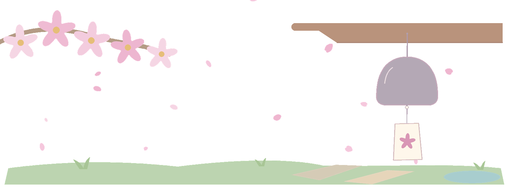

  

 

    

<h3>🌸 About Me</h3>

  Student at Korea University.

  I enjoy building small tools and exploring creative ideas.

  Still learning step by step.

<a href="https://xhslink.cn/o/4QsNglT4bkY"><picture><source media="(prefers-color-scheme: dark)" srcset="./assets/xiaohongshu_white.svg"></picture></a>&nbsp;&nbsp;<a href="https://www.instagram.com/muulikecake/"><picture><source media="(prefers-color-scheme: dark)" srcset="./assets/instagram_white.svg"></picture></a>&nbsp;&nbsp;<a href="https://www.youtube.com/@muulikecake"><picture><source media="(prefers-color-scheme: dark)" srcset="./assets/youtube_white.svg"></picture></a>&nbsp;&nbsp;<a href="https://www.tiktok.com/@muulikecake"><picture><source media="(prefers-color-scheme: dark)" srcset="./assets/tiktok_white.svg"></picture></a>

 

 

  <picture>
    <source
      media="(prefers-color-scheme: dark)"
      srcset="https://raw.githubusercontent.com/MuuCake/MuuCake/output/github-contribution-grid-snake-dark.svg"
    >
    
  </picture>

 

  

 

  

