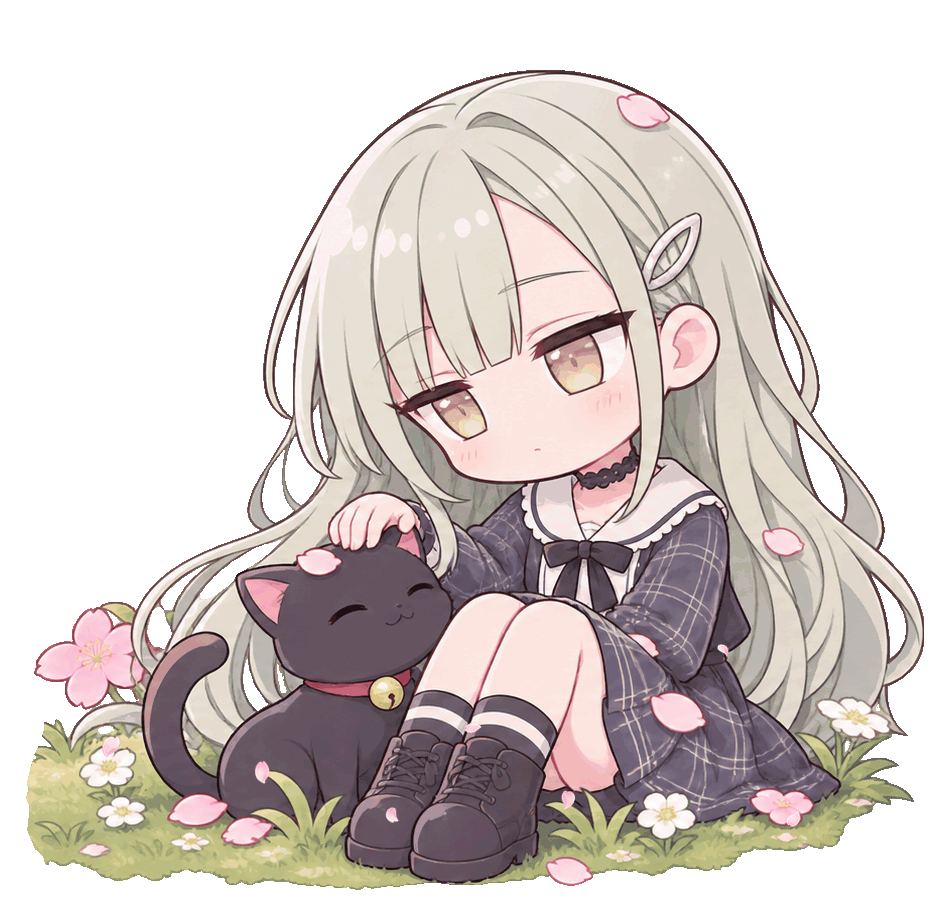

  

 

<h2>🌸 About Me</h2>

  Mechanical Engineering student at Korea University.

  I enjoy building small tools and exploring creative ideas.

  Still learning step by step.

 

 

  <picture>
    <source
      media="(prefers-color-scheme: dark)"
      srcset="https://raw.githubusercontent.com/MuuCake/MuuCake/output/github-contribution-grid-snake-dark.svg"
    >
    
  </picture>

 

  

 

  

